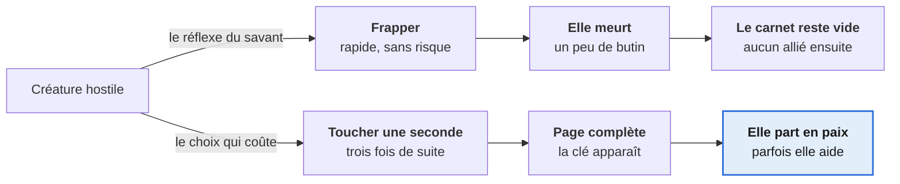
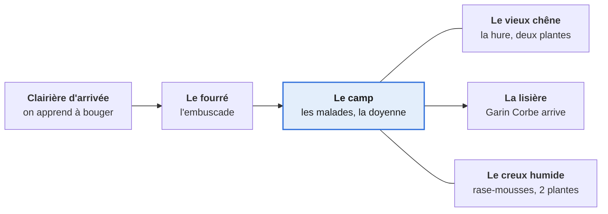

# Le Dernier Spécimen

*Game Design Document — tranche verticale v1*

24 octobre 2026 · David

## Pitch et intention

*Le Dernier Spécimen* est un RPG d'action en vue de dessus où l'on progresse en comprenant les monstres plutôt qu'en les tuant — et où comprendre coûte plus cher que tuer.

> Gojo est le meilleur cryptozoologue de son époque. Dans son laboratoire, il capture, il dissèque, il classe. Son carnet de terrain est presque complet — il ne lui manque qu'une page.
>
> Le Dieu des monstres, lui, a fini de compter ses morts. Il ne le tue pas : il le jette mille ans en arrière, dans un monde où la magie coule partout et où les monstres sont partout aussi. *« Vas-y. Étudie-les donc pour de vrai. »*
>
> Première rencontre : un gobelin, seul, de dos. Réflexe de savant — il attaque. Et trois autres gobelins jaillissent des fourrés pour défendre leur copain. Il s'en sort de justesse, et il comprend ce qu'aucune dissection ne lui avait montré : ils s'entraident. Ils ont peur. Ils ont une famille.
>
> Son carnet se remplit désormais autrement : en observant, en écoutant, en soignant. Et ce qu'il y découvre, il veut le prouver aux humains de cette époque — en commençant par un camp de gobelins, et un chasseur décidé à le brûler.
>
> Tous les monstres ne sont pas ses amis. Tous les humains ne sont pas ses ennemis. Et le Dieu des monstres le regarde.

**Le thème, en une phrase.** Comprendre coûte plus cher que tuer, et rapporte davantage. Ce n'est pas une morale posée sur le jeu par les dialogues : c'est l'économie même du jeu, inscrite dans le risque pris et dans la récompense obtenue. Un joueur qui ne lit aucun texte doit pouvoir le ressentir.

**La promesse joueur.** Vingt minutes dans une forêt hostile, au terme desquelles les créatures qu'on croyait être des obstacles se battent à vos côtés.

**Périmètre de ce document.** Ce GDD décrit uniquement la **tranche verticale v1** : une zone, une quête, un boss, environ vingt minutes de jeu. Tout ce qui relève du jeu complet est soit listé en hors périmètre, soit signalé comme *crochet* — une porte laissée ouverte, mais pas construite.

## Personnages et monde

Cinq personnages suffisent à la tranche verticale, et un seul objet porte tout le jeu : les gants de Gojo.

| Personnage | Ce qu'il est | Ce qu'il veut | Rôle dans la v1 |
| --- | --- | --- | --- |
| **Gojo** | Savant-magicien d'un futur proche, exilé mille ans en arrière | Au départ : compléter son carnet. À la fin : prouver qu'il s'est trompé | Personnage joueur |
| **Le Dieu des monstres** | Grand humanoïde non armé, en colère, triste, surtout déçu des humains | Que quelqu'un, enfin, regarde ses créatures au lieu de les compter | Intro, puis silhouette muette en lisière de forêt |
| **Greg**, le gobelin épargné | Le premier gobelin que Gojo attaque — et qui le sauve ensuite | Que l'étranger reparte, puis qu'il soigne les siens | Guide vers le camp, premier visage ami |
| **Lila**, la doyenne du camp | Ancienne gobeline, soigne les malades sans y arriver | Des plantes, et qu'on lui foute la paix | Donne la quête, valide les remèdes |
| **Garin Corbe** | Chasseur de primes humain, carnet à la ceinture | Être payé. Il n'a rien contre les gobelins en particulier | Boss de la tranche |

### Les gants d'analyse

Gojo porte des gants de laboratoire qui **analysent au toucher**. Il faut poser la main sur la chose — une plante, un mécanisme, une créature vivante et en mouvement — et tenir le contact environ une seconde.

C'est la décision de conception la plus importante du jeu, et elle vient de l'idée de contact : **analyser oblige à s'approcher**. Un scanner à distance aurait été gratuit, donc sans intérêt. Là, chaque page du carnet se paie en risque pris.

Dans son époque, les gants servaient à manipuler des spécimens morts sans se contaminer. Ici, saturés de la magie de cette ère, ils lisent le vivant — et Gojo est le premier surpris. *Crochet pour la suite : d'autres fonctions apparaissent au fil du jeu (soigner, dissiper, comprendre un langage). La v1 n'en implémente aucune.*

### Les trois forces en tension

Le monde n'est pas « les monstres contre les humains », et c'est ce qui empêche le jeu de devenir une leçon de morale. Trois forces s'opposent deux à deux : les **humains** (dont certains ne demandent qu'à être convaincus), les **monstres sociaux** comme les gobelins, et les **monstres hostiles** — à Gojo, mais aussi aux gobelins. Une créature peut être dangereuse sans être mauvaise : c'est précisément ce que le carnet sert à démêler.

## Le verbe central : analyser au toucher

Analyser est la seule action du jeu qui serve à la fois au combat, à l'exploration et aux énigmes — et c'est aussi la plus dangereuse.

L'analyse exige le **contact**. Gojo doit poser la main sur la créature et tenir une seconde pleine, pendant laquelle il ne peut ni frapper ni esquiver. Un coup reçu annule l'analyse en cours. Il faut trois analyses réussies pour compléter une page.

Tout découle de là. Un scanner à distance aurait rendu la connaissance gratuite, donc ennuyeuse, et le thème décoratif. Le toucher fait l'inverse : il rend la compréhension **plus difficile que la violence**. Le joueur ressent le thème dans ses doigts avant de le lire dans un dialogue.

**Seule la voie difficile remplit le carnet** — deux façons de régler une rencontre, une seule fait progresser Gojo.



*Un coup reçu pendant le contact annule l'analyse en cours.*

*Les deux issues d'une rencontre · 2 voies, 1 récompense.*

La voie du haut est toujours disponible et toujours plus facile. C'est voulu : un choix moral sans tentation n'est pas un choix.

### Les trois registres

- **En combat** — chaque analyse est une prise de risque volontaire au corps à corps. La page complétée révèle la *clé* de la créature : ce qui la calme, la détourne ou la soulage.
- **En exploration** — plantes, champignons, traces, mécanismes. Sans risque, mais il faut prendre le temps de s'arrêter.
- **En énigme** — analyser un gobelin malade donne son symptôme ; analyser les plantes donne leurs propriétés ; c'est au joueur de faire correspondre les deux.

### Le garde-fou à surveiller

Si tuer est plus facile **et** suffisant, tout le monde tuera. La correction tient en une règle de conception : **les pages du carnet sont la seule progression du jeu**. Pas d'expérience, pas de niveaux, pas de meilleure épée. Une créature tuée ne laisse rien qu'on ne puisse obtenir autrement ; une créature comprise laisse une page, et les pages ouvrent la fin de la tranche. C'est le seul point d'équilibrage dont dépend le thème : il doit être testé en premier.

## Boucle de jeu et systèmes v1

Six systèmes suffisent, et aucun n'est optionnel : si l'un saute, la tranche ne tient plus debout.

**Déplacement.** Huit directions, accélération courte, et une **roulade** avec brève invincibilité. La roulade n'est pas un ornement : elle est l'outil qui permet d'entrer au contact pour analyser. Sans elle, l'analyse en combat est injouable.

**Combat.** Une arme de mêlée unique — un bâton ferré ramassé au début. Un seul coup, un seul bouton, pas de combo. Toute la profondeur vient du choix *frapper ou toucher*, pas de la variété des attaques.

**Analyse.** Un bouton maintenu au contact d'une cible. Une barre circulaire se remplit ; un coup reçu la vide. Trois analyses réussies complètent la page de l'espèce.

**Résolutions non létales.** Une page complète révèle la *clé* de la créature, et la clé devient une action contextuelle disponible près d'elle. Trois clés dans la v1, une par créature.

**Plantes et soin.** Quatre plantes dans la zone, ramassables, quatre emplacements maximum. Pas d'inventaire général : une barre de quatre cases, visible en permanence. Donner une plante à un gobelin malade est une action contextuelle, et le mauvais remède aggrave son état de façon visible — c'est le retour d'erreur de l'énigme.

**Dialogue.** Une boîte de texte, pas d'arbre, pas de choix — sauf une fois, à la fin du combat de boss. Les gobelins parlent par phrases courtes et mal construites, jamais en langage de bébé : ils ne sont pas bêtes, ils parlent une langue qui n'est pas la leur.

### Valeurs de départ

À exposer en `@export` dans Godot pour que l'équilibrage se fasse dans l'inspecteur, sans toucher au code. Ce sont des points de départ plausibles, pas des vérités : ils seront tous faux au premier test.

| Paramètre | Départ | Notes |
| --- | --- | --- |
| Vitesse de marche | 80 px/s | Base 320×180 ; à régler en premier, avant tout le reste |
| Roulade | 220 px/s pendant 0,25 s | Invincible pendant 0,2 s, recharge 0,6 s |
| PV de Gojo | 6 (3 cœurs) | Invincibilité de 0,8 s après un coup |
| Attaque | 1 dégât, cadence 0,35 s | Portée courte, recul léger sur la cible |
| Durée d'une analyse | 1,0 s de contact | Interrompue par tout dégât subi |
| Analyses par page | 3 | Le chiffre qui décide du rythme de toute la tranche |
| PV gobelin / sanglier / rase-mousse | 3 / 8 / 2 | Le sanglier doit faire peur, pas être long |

### La boucle de session

Entrer dans une zone → rencontrer une créature → choisir entre frapper et toucher → remplir une page → la page ouvre un passage, un remède ou un allié → avancer. Vingt minutes de cette boucle, puis le boss.

## Le carnet de terrain

Le carnet est à la fois l'interface, la progression, le journal de quête et l'arc du personnage. C'est le seul système qu'il faut réussir.

### L'idée qui porte tout : la page change de ton

Une page commence en langage de laboratoire et finit en langage humain.

> **Avant** — *Spécimen G-04. Humanoïde de petite taille, agressivité en meute, valeur d'étude faible.*
>
> **Après** — *Kreg. Il a peur du feu depuis l'incendie. Il cache de la nourriture pour sa sœur.*

Mécaniquement, c'est deux états de texte par page et rien de plus. Narrativement, c'est tout le jeu : le joueur voit Gojo changer dans son écriture, sans qu'aucun personnage ait à le dire à voix haute. **C'est l'effet à ne sacrifier sous aucun prétexte.**

### Ce qu'une page contient

Nom de terrain (puis nom véritable) · croquis · trois lignes d'observation, une par analyse réussie · **la clé** : ce qui calme la créature sans la tuer.

La clé n'apparaît qu'à la troisième observation. Elle devient alors une action contextuelle disponible près de cette espèce, pour toujours.

### Contenu de la v1

- **Quatre pages de créature** : gobelin, hure des souches, rase-mousse, et Garin Corbe lui-même.
- **Un herbier de quatre plantes** : une seule analyse par plante, pas de clé.
- **Aucune autre progression.** Pas d'expérience, pas de niveaux, pas d'équipement, pas d'amélioration d'arme. Les pages sont la seule chose qui s'accumule.

### Modèle de fiche à remplir

À imprimer et à remplir à la main avant de coder quoi que ce soit — une fiche par créature. Une créature dont la fiche ne se remplit pas n'a rien à faire dans le jeu.

```text
NOM DE TERRAIN (ce que Gojo écrit avant de comprendre) :
NOM VÉRITABLE (ce que les gobelins lui apprennent) :

Allure, taille :
Comment elle se déplace :
Ce qu'elle fait quand elle a peur :
Ce qu'elle protège :

Observation 1 :
Observation 2 :
Observation 3 :

LA CLÉ — ce qui la calme sans la tuer :
Ce qu'elle fait si on la laisse partir :

Dessin :
```

## La tranche verticale : Le Bois des Souches

Une forêt, six lieux, vingt minutes, et un seul objectif : empêcher un homme de brûler un camp.

**Tout ramène au camp des gobelins** — le Bois des Souches, une zone continue sans chargement.



*Flèche = passage à sens unique la première fois. Trait simple = aller-retour libre.*

*Le Bois des Souches · 6 lieux, 1 centre.*

### Déroulé beat par beat

1. **L'arrivée** *(0-2 min)* — Gojo tombe dans la clairière. On apprend à marcher, rouler, ramasser un bâton. Aucun ennemi.
2. **Le réflexe** *(2-5 min)* — Un gobelin, seul, de dos. Le jeu invite à l'attaquer : cadrage, musique, prompt d'attaque. Dès le premier coup, trois gobelins surgissent. **Ce combat est impossible à gagner, par construction.** Gojo tombe à un point de vie, et les gobelins s'arrêtent au lieu d'achever.
3. **Le camp** *(5-8 min)* — Le gobelin épargné le conduit au camp. Familles, bébés, et beaucoup de malades couchés. La doyenne ne demande rien : elle lui tourne le dos. Analyser un malade (premier usage libre du gant) révèle le symptôme et ouvre la quête.
4. **La cueillette** *(8-15 min)* — Le vieux chêne et le creux humide. Quatre plantes à analyser, deux créatures hostiles à gérer. C'est le cœur jouable : c'est là que le joueur décide, trois ou quatre fois, s'il frappe ou s'il touche.
5. **Le remède** *(15-17 min)* — Les malades se relèvent. Le camp change d'attitude envers Gojo. Respiration volontaire : pas de combat, un peu de musique, deux lignes de dialogue.
6. **La lisière** *(17-22 min)* — Garin Corbe arrive avec une torche. Combat de boss, puis l'une des deux fins.

### Les créatures

| Créature | Comportement | La clé (révélée par la page) |
| --- | --- | --- |
| **Gobelin** | Fuit seul, attaque en meute si l'un des siens est touché | Partager de la nourriture au lieu de dégainer |
| **Hure des souches** | Charge en ligne droite, s'assomme contre un arbre | Une épine fichée dans l'épaule, à retirer au gant |
| **Rase-mousse** | Nuée, harcèle sans jamais tenir en place | Le pollen de fleur-trompette les endort |
| **Garin Corbe** | Arbalète à distance, lame au contact | Il est payé, il a déjà été mordu, il a peur |

### L'énigme des malades

Les gobelins ont **de la fièvre et des taches noires** — deux symptômes, donc deux remèdes à trouver. Quatre plantes poussent dans le bois :

- **Mousse-de-lune** — fait tomber la fièvre.
- **Ronce-rouge** — toxique, et *ressemble beaucoup* à la mousse-de-lune. Seule l'analyse les distingue. C'est le piège de l'énigme, et la seule bonne raison d'avoir des gants.
- **Capuchon gris** — referme les taches.
- **Fleur-trompette** — endort. Inutile pour la maladie, indispensable contre les rase-mousses et utilisable sur Garin.

Donner la ronce-rouge ne tue personne : le gobelin tousse, la doyenne reprend la plante des mains de Gojo et la jette. L'erreur coûte du temps et de la honte, pas une vie.

### Le combat de boss

**Phase 1** — Garin tire à l'arbalète et pose des pièges. Le joueur doit fermer la distance : exactement le geste que l'analyse lui a appris pendant vingt minutes.

**Phase 2** — À mi-vie, il jette l'arbalète et passe à la lame. Plus rapide, plus lisible.

**Le renfort** — Si les malades ont été soignés, les gobelins entrent dans le combat au début de la phase 2. Ils ne font presque pas de dégâts : ils font diversion, et c'est l'écho exact du beat 2. *Ils étaient venus sauver leur copain ; ils viennent maintenant sauver Gojo.* C'est le sommet émotionnel de la tranche, et il coûte peu à produire.

**Les deux fins** — Garin tombé à terre, deux issues selon que sa page est complète ou non :

- **Page incomplète** — il s'enfuit en jurant de revenir avec dix hommes. Fin « ouverte », légèrement amère.
- **Page complète** — Gojo lui tend le carnet. Garin lit, se tait, laisse tomber sa torche et s'en va. Il laisse derrière lui sa propre liste de primes — le dernier objet de la tranche, et la promesse du jeu complet.

Coût réel de cette double fin : une condition et quelques lignes de dialogue. Rapport qualité/effort imbattable.

## Hors périmètre v1

Cette section est la plus utile du document. Un projet de jeu amateur ne meurt presque jamais d'une mauvaise idée : il meurt d'avoir dit oui à toutes.

| Ce qu'on ne construit pas | Pourquoi |
| --- | --- |
| Capture de monstres | Roster, statistiques, équipe, équilibrage : c'est un jeu entier à lui seul. Le plaisir de collection passe par les pages du carnet |
| Inventaire et équipement | Quatre cases de plantes suffisent à la tranche |
| Niveaux, expérience, arbre de compétences | Le carnet est la seule progression, par choix de conception |
| Nouvelles fonctions des gants | Crochet pour la suite, explicitement non construit |
| Sauvegarde | Vingt minutes se jouent d'une traite |
| Autres zones, monde ouvert | La zone suivante se construit après avoir fini celle-ci, jamais avant |
| Réputation, karma, jauge de moralité | La récompense asymétrique suffit à porter le thème |
| Cinématique animée | L'intro est en texte sur images fixes, comme décidé |
| Musique originale | Musique libre de droits d'abord ; la composition viendra si le jeu continue |
| Menu d'options complet, traduction, doublage | Volume et « quitter » suffisent |

### La règle du bocal à idées

Ton fils va avoir des idées en permanence, et la plupart seront bonnes. Le réflexe tentant — les intégrer tout de suite — est exactement ce qui tue les projets.

La règle : **toute idée qui n'est pas dans ce document part dans le [bocal à idées](../BOCAL_A_IDEES.md)**, un simple fichier texte listé par date. Rien n'est jeté, rien n'est refusé, et rien n'entre en v1. On ouvre le bocal le jour où la tranche verticale est finie et jouable du début à la fin.

C'est une règle pour vous deux, pas une règle pour lui.

## Direction artistique et sonore

Le choix directeur : **le code ne doit jamais attendre l'art**. Tant qu'une mécanique n'est pas amusante avec des rectangles de couleur, aucun sprite ne la sauvera.

### Contraintes techniques

| Paramètre | Choix | Pourquoi |
| --- | --- | --- |
| Résolution de base | 320 × 180, agrandie en entier (×3, ×4, ×6) | Ratio 16:9 exact, pas de pixels déformés |
| Tuiles | 16 × 16 px | Standard, compatible avec la plupart des packs libres |
| Personnages | 24 × 24 px | Lisibles à cette résolution, rapides à dessiner |
| Palette | 24 à 32 couleurs, une seule pour tout le jeu | Rend cohérent même un art débutant, et réduit les décisions |
| Directions d'animation | 4 (haut, bas, gauche, droite) | Le déplacement reste à 8 directions. Les 4 diagonales doubleraient le travail de dessin pour un gain quasi nul |

Animations minimales par personnage : repos 2 images, marche 4, attaque 3, analyse 2 + un effet lumineux au gant. Rien d'autre.

**Règle de lisibilité** : une créature doit être reconnaissable à sa silhouette en noir. Si elle ne l'est pas, c'est la forme qu'il faut corriger, pas les couleurs.

### Outils

- **[Pixelorama](https://github.com/orama-interactive/Pixelorama)** — éditeur de pixel art gratuit et open source, lui-même écrit avec Godot ([présentation](https://itsfoss.com/pixelorama/)). Le bon point de départ pour ton fils.
- **Aseprite** — l'outil de référence du milieu, mais payant. À envisager seulement si le projet dure.

### Assets de départ

L'art définitif se dessine en dernier. Pour prototyper :

- **[Kenney](https://kenney.nl/assets)** — packs explicitement **CC0** (domaine public, aucune attribution requise). C'est la source la plus sûre juridiquement, et la plus simple à expliquer à un enfant.
- **[OpenGameArt](https://opengameart.org/)** et **itch.io** — beaucoup de matériel, mais les licences varient d'un pack à l'autre (CC0, CC-BY avec attribution obligatoire, parfois usage non commercial). **À vérifier pack par pack**, et à noter dans un fichier `CREDITS.md` au fur et à mesure. C'est fastidieux sur le moment et impossible à reconstituer après coup.

Remplacer progressivement : un sprite dessiné par ton fils écrase un placeholder sans toucher au code, à condition de garder les mêmes dimensions et le même point d'ancrage.

### Son

Un seul son compte vraiment : **celui de l'analyse qui aboutit**. C'est la récompense de la prise de risque, et il doit être net, court et satisfaisant. Le second par ordre d'importance est le bruit de la plume qui remplit une ligne du carnet.

Tout le reste — pas, coups, cris, ambiance de forêt — vient de banques libres. Musique libre de droits pour la v1 ; trois morceaux suffisent : forêt, camp, boss.

## Plan de production

L'ordre compte plus que le contenu : chaque jalon se termine par quelque chose de **jouable**, et on ne commence le suivant qu'une fois le critère de sortie atteint.

**Version de Godot** — la branche stable actuelle est [Godot 4.7.2](https://godotengine.org/article/maintenance-release-godot-4-7-2/), publiée le 18 août 2026. Fixez la version au début et ne la changez plus avant la fin de la tranche : une mise à jour en cours de route est un risque gratuit.

### Les jalons

| Jalon | Ce qu'on construit | Critère de sortie | Ordre de grandeur |
| --- | --- | --- | --- |
| **0 — Le carré qui bouge** | Projet Godot, `CharacterBody2D`, 8 directions, roulade, caméra | Se déplacer est agréable, sans décor et sans ennemi | 1 séance |
| **1 — Taper et être tapé** | `Area2D` hitbox/hurtbox, PV, recul, invincibilité, un ennemi qui fonce | On comprend à l'écran qui a touché qui | 2 séances |
| **2 — Le gant** | Analyse au contact, barre de maintien, interruption, une page qui se remplit | On sent le risque de s'approcher | 2 séances |
| **3 — Le carnet** | Interface du carnet, trois observations, la clé, une résolution non létale sur la hure | Quelqu'un d'extérieur préfère la voie non létale | 2 séances |
| **4 — La zone** | TileMap des six lieux, PNJ gobelins, dialogue, quatre plantes, énigme des malades | La quête se termine sans que vous ayez à intervenir | 4 séances |
| **5 — Le boss** | Garin Corbe, deux phases, renfort gobelin, les deux fins | La tranche se joue du début à la fin | 3 séances |
| **6 — L'habillage** | Intro texte sur images fixes, sons, menu minimal, écran de fin | C'est montrable à un copain | 2 séances |

Soit une quinzaine de séances dans le meilleur des cas. À deux séances par semaine, comptez **trois à six mois** — et cette estimation est probablement optimiste, comme toutes les estimations de jeu vidéo. Le critère de sortie du jalon 3 est le plus important du tableau : s'il n'est pas atteint, la suite ne sert à rien.

### La décision d'architecture qui change tout

Définir chaque créature comme une **`Resource` Godot** (`creature_gobelin.tres`), avec ses champs exposés dans l'inspecteur : nom de terrain, nom véritable, PV, vitesse, sprite, les trois lignes d'observation, le texte de la clé.

Ton fils peut alors créer, équilibrer et écrire une créature entière **sans jamais ouvrir un fichier de code**. Même chose pour les plantes et pour les valeurs du personnage, en `@export`. C'est ce qui fait la différence entre un enfant qui regarde son père coder et un enfant qui fabrique le jeu.

### Répartition

| Chantier | Lui | Toi |
| --- | --- | --- |
| Fiches de créature, textes du carnet, dialogues gobelins | ✓ | relecture |
| Sprites, animations, palette | ✓ | intégration |
| Plan de la zone sur papier, puis TileMap | ✓ | structure de la scène |
| Équilibrage des valeurs dans l'inspecteur | ✓ | exposition des `@export` |
| Test à chaque fin de jalon, et verdict | ✓ | se taire et noter |
| Physique, machines à états, interface, intégration | | ✓ |
| Git, sauvegarde du projet, exports | | ✓ |

Deux habitudes qui coûtent peu et rapportent beaucoup : un **dépôt git dès le jalon 0**, avec des commits faits ensemble et nommés par lui ; et un **test par un tiers** — un copain de son âge — dès le jalon 3. Vous serez tous les deux incapables de voir ce qui ne va pas dans votre propre jeu.

## Risques et décisions ouvertes

Rien dans cette section ne bloque le démarrage : le jalon 0 peut commencer ce soir.

### Décisions à prendre

| Question | Qui tranche | Avant quel jalon | Décision |
| --- | --- | --- | --- |
| Nom et apparence précise du Dieu des monstres | Ton fils | 6 | |
| Noms du gobelin épargné et de la doyenne | Ton fils | 4 | Greg et Lila |
| Les gobelins du camp sont-ils attaquables ? | Vous deux | 4 | Non, pas en v1 |
| Le Dieu apparaît-il en silhouette pendant la tranche ? | Vous deux | 5 | |
| Garder le nom « Gojo » | Ton fils | 6 | |
| Titre définitif | Vous deux | après 6 | |

**Sur les gobelins attaquables** — recommandation : non, pas de boîte de collision du tout dans le camp. Permettre de frapper des alliés oblige à gérer un état « le camp vous rejette » qui coûte cher et que presque personne ne verra. *Décidé : non pour la v1. Un système de réputation part dans le bocal à idées.*

**Sur la silhouette du Dieu** — recommandation : oui. Un sprite immobile, aperçu deux ou trois fois en lisière, qui disparaît quand on s'approche. Zéro mécanique, gros effet d'ambiance.

**Sur le nom « Gojo »** — à savoir avant de s'y attacher : c'est aussi le nom d'un personnage très connu de *Jujutsu Kaisen* ([Satoru Gojo](https://en.wikipedia.org/wiki/Satoru_Gojo)). Sans aucune importance pour un projet familial, et sans doute précisément pour ça qu'il a été choisi. À reconsidérer seulement si le jeu sortait du cercle familial un jour.

### Risques

| Risque | Comment on le voit venir | Garde-fou |
| --- | --- | --- |
| Le périmètre gonfle | Une idée nouvelle est implémentée « vite fait » | Le bocal à idées, sans exception |
| La voie non létale n'est pas plus satisfaisante | Au test du jalon 3, le testeur frappe tout | Arrêter et revoir la récompense avant d'aller plus loin. C'est le seul risque qui peut condamner le concept |
| L'art bloque le code | « On ne peut pas tester, il manque le sprite » | Rectangles de couleur, toujours |
| Le combat perdu d'avance frustre | Les testeurs le rejouent en boucle en croyant pouvoir gagner | Il doit durer moins de quinze secondes et la défaite doit être évidente |
| Le double standard moral revient | Gojo tue des humains après avoir épargné des monstres | Dans la v1, Garin ne meurt pas. Les humains se rendent, fuient ou écoutent |
| Ton fils décroche | Il ne demande plus à tester | Un chantier à lui dans chaque jalon, jamais « plus tard ». Et le droit d'arrêter sans que ça soit un échec |

Le dernier risque est le seul qui compte vraiment. Le jeu est un prétexte à passer du temps ensemble ; s'il faut choisir entre finir la tranche verticale et garder l'envie de ton fils, le choix est fait d'avance.
